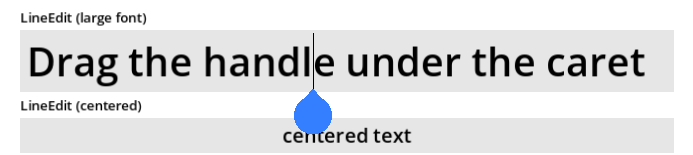
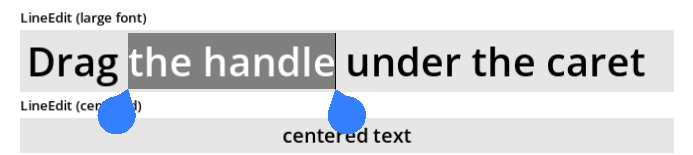
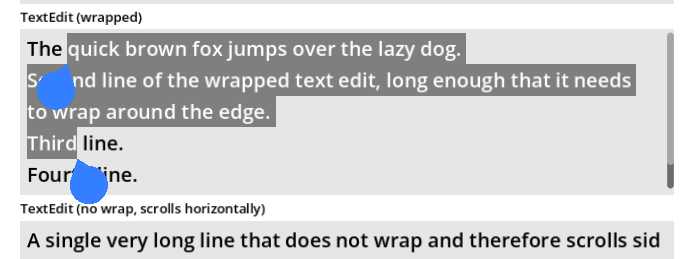
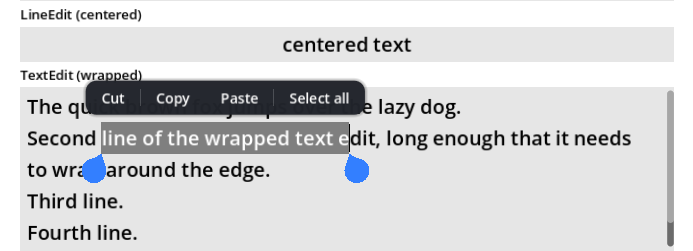

# Mobile Caret for Godot 4

Touch-friendly text carets and selection handles for Godot 4, in the style of Android. Drop it into your project and every `LineEdit` and `TextEdit` gets draggable handles, with no per-scene setup.

## Motivation

Godot's built-in caret is a thin line that is hard to see and almost impossible to place precisely with a finger. This plugin adds Android-style handles with a finger-sized grab area, so editing text on a phone feels natural.

## Screenshots

A caret handle under the caret in a `LineEdit`. Drag it to move the caret:



Two handles around a selection in a `LineEdit`:



A selection spanning several lines of a wrapped `TextEdit`:



The optional floating Cut / Copy / Paste / Select all toolbar:



## Features

* **Draggable caret handle:** a handle appears under the caret; drag it to move the caret.
* **Selection handles:** when text is selected, two handles mark the start and end. Drag either one to adjust the selection, and they can cross over each other.
* **Long-press to select a word.**
* **Smooth dragging:** the handle follows your finger while the caret snaps to the nearest character. Dragging past the edge of a control scrolls it.
* **Floating toolbar (optional):** an Android-style Cut / Copy / Paste / Select all bar above the selection. It lives in its own folder, nothing else depends on it, and it can be switched on and off from code.
* **Auto-fading caret handle:** the single caret handle fades out after a few seconds of inactivity and returns when you tap or move the caret. Selection handles stay visible.
* **Native caret hiding:** optionally hide Godot's own thin caret while a handle is shown, or only while dragging.
* **Works with what you already have:** supports `LineEdit`, `TextEdit`, `CodeEdit` and the `LineEdit` inside a `SpinBox` (including wrapped text, scrolling, gutters, alignment, clear buttons, secret fields and different font sizes) without changing your scenes. The text control keeps focus, so the on-screen keyboard stays up while you drag.
* **Right-to-left and mixed-direction text:** Hebrew, Arabic and mixed text get correctly placed handles, in left-to-right and right-to-left layouts.
* **Windows and SubViewports:** controls in a separate `Window`, an embedded window or a `SubViewport` get their handles and toolbar inside their own viewport.
* **Multiple carets:** a `TextEdit` with several carets gets handles for every caret, each draggable on its own.
* **Customizable:** use your own handle texture, size and color.
* **Your own toolbar buttons:** add buttons (or a submenu) at the position you choose; index 0 is the leftmost.
* **A menu for each control:** switch the menu off for one control, or choose which buttons it may have (only Copy for a note, Copy / Cut / Delete for a field), from code.
* **Menus on images:** a long press on an image (or any control without text) opens the toolbar with a built-in **Copy image** (Android and Windows, from GDScript only) and the buttons you give it, such as "Save image". It stays away from the spots of an interactive view (a slider, a node) that answer `is_interactive_at()`.
* **Custom controls:** your own text or math editors get the handles and the toolbar too. Return a small delegate object from `_get_caret_delegate()`, with no dependency on MobileCaret, or register an adapter from code (see [Custom controls](#custom-controls)).

## Installation

1. Download the repository (or use the Asset Library) and copy `addons/MobileCaret` into your project's `addons/` folder.
2. Open *Project Settings > Plugins* and enable **MobileCaret**. This registers two autoloads: `MobileCaret` (the handles) and `MobileCaretToolbar` (the optional toolbar).

That's it. Run your project and focus any `LineEdit` or `TextEdit`.

If you prefer not to use the plugin, add `addons/MobileCaret/CaretsController/carets_controller.tscn` (and, if you want the toolbar, `addons/MobileCaret/Toolbar/caret_toolbar.tscn`) as autoloads yourself.

An example scene is included at `addons/MobileCaret/Examples/example_scene.tscn`.

## Usage

* **Move the caret:** drag the handle under the caret.
* **Select text:** long-press a word (or double-tap). Two handles appear; drag them to adjust the selection.
* **Replace or collapse a selection:** just type, or tap elsewhere, as usual.

### Settings

Select the `MobileCaret` autoload (or `carets_controller` node) and adjust its exported properties, or set them from code, for example `MobileCaret.handle_color = Color.ORANGE`.

#### Look

| Property | Description |
| --- | --- |
| `texture_caret` | Optional custom handle texture. Leave empty for the default teardrop. |
| `handle_size_mm` | Physical size of a handle in millimeters (default 4.4 × 5, close to the platform handles). The handle keeps this size on screen whatever the resolution, aspect ratio, stretch mode or screen DPI, and the hit margin, drag threshold and edge-scroll zones scale with it. Set to `(0, 0)` to use `handle_size` instead. |
| `handle_size` | Size of a handle in logical pixels. Used when `handle_size_mm` is `(0, 0)`. |
| `handle_color` | Color of the default teardrop. |
| `caret_texture_offset` | Extra offset applied to the handles. |
| `hit_margin` | Extra pixels around a handle that still count as touching it. |
| `min_touch_mm` | The smallest area a handle can be grabbed in, in millimeters (default 7, about the platforms' 48 dp touch target). A small handle gets a wider grab margin. |

#### Gestures

| Property | Description |
| --- | --- |
| `long_press_seconds` | How long to press to select a word. `0` disables long-press. |
| `release_focus_on_tap_outside` | Tapping outside the focused text control (the background, a label, empty space) takes the focus away, like Android: the caret, the selection and the handles go away (default on). Godot itself keeps the focus on such taps. Taps on buttons, the toolbar, the handles, controls that take the focus themselves, and controls marked with the `mobile_caret_keep_focus` meta (and everything inside them) keep it. A drag, such as scrolling, never releases it. |

To keep the focus when a tap lands on a panel of your own (an on-screen keypad, say), mark it:

```gdscript
my_keypad.set_meta(&"mobile_caret_keep_focus", true)
```

An overlay drawn outside the GUI (like the toolbar) can join the `mobile_caret_overlay` group and implement `covers_point(point: Vector2, viewport: Viewport) -> bool`.

#### Fade

| Property | Description |
| --- | --- |
| `caret_fade_delay` | Seconds of inactivity before the caret handle fades out. `0` or less disables fading. |
| `caret_fade_duration` | How long the fade takes, in seconds. |

#### Native caret

| Property | Description |
| --- | --- |
| `hide_native_caret` | Hide Godot's thin caret whenever a handle is shown. |
| `hide_native_caret_while_dragging` | Hide it only while a handle is being dragged (on by default). |

If a control already has its own `caret_color` override, it is restored exactly when the native caret is shown again.

### Floating toolbar

The toolbar (`addons/MobileCaret/Toolbar`) is a separate autoload, `MobileCaretToolbar`. Nothing in the handles' code depends on it: remove its autoload, or switch it off in code, and everything else works the same. If the `MobileCaret` controller is present the toolbar also listens to its `handle_tapped` signal; without it the toolbar still works from focus and selection alone. It works for `LineEdit`, `TextEdit`, `CodeEdit`, the `LineEdit` inside a `SpinBox` and selectable `RichTextLabel`s, and custom controls (see [Custom controls](#custom-controls)), in the main window and in any other `Window` or `SubViewport`. A `RichTextLabel` gets the toolbar only: Godot cannot set its selection from code, so there are no selection handles for it.

* It appears above a selection once the selection has settled and no mouse button is held, so it stays out of the way while you drag a handle. If there is no room above, it goes below the selection, clear of the handles and the area they are grabbed in. It keeps its physical size, only shrinking when a small viewport is too narrow for it.
* It only offers what applies: Cut and Paste need an editable control, Paste needs something on the clipboard, and Select all is hidden when everything is already selected. The clipboard is read when the toolbar appears and then about twice a second while it stays (on a phone each read is a call to the system), so text copied in another app adds Paste within half a second. A password field (`secret`) never offers Copy, Cut or Share.
* Tapping a caret handle (without dragging) shows Paste / Select all at the caret.
* Tapping inside an existing selection keeps the selection and shows or hides the toolbar, like Android.
* After Copy the selection stays and the toolbar hides until the selection changes (or you tap it). Typing or moving the caret hides it too.
* The **···** button opens an overflow menu with Undo, Redo and (optionally) Share; **‹** goes back.
* **Delete** (off by default, like Share) removes the selected text without copying it. It shows only for text that can be edited.

Control it from code:

```gdscript
MobileCaretToolbar.enabled = false      # switch it off, and back on with true
MobileCaretToolbar.show_for_caret()     # show Paste / Select all at the caret now
MobileCaretToolbar.hide_toolbar()       # hide it until the selection changes
MobileCaretToolbar.action_pressed.connect(func(action): print(action))  # "cut", "copy", "paste", "select_all", "delete", "undo", "redo", "share"
MobileCaretToolbar.show_delete = true   # the Delete button (off by default)

# The Share button only shows when you turn it on; the toolbar cannot share by itself.
MobileCaretToolbar.show_share = true
MobileCaretToolbar.share_requested.connect(func(text): print("share: ", text))
```

| Property | Description |
| --- | --- |
| `enabled` | Master switch. |
| `show_cut`, `show_copy`, `show_paste`, `show_select_all` | Turn individual buttons off. |
| `text_cut`, `text_copy`, `text_paste`, `text_select_all` | Button labels (for localization). |
| `show_delete`, `text_delete` | The Delete button (off by default) and its label. |
| `show_copy_image`, `text_copy_image` | Copy image in the menu of an image (on by default; shown where the system clipboard can take an image) and its label. |
| `show_overflow`, `show_undo`, `show_redo`, `show_share` | The overflow menu and its entries (Share is off by default). |
| `text_undo`, `text_redo`, `text_share`, `text_more`, `text_back` | Labels for the overflow menu. |
| `tap_selection_toggles_toolbar` | Tapping inside a selection keeps it and toggles the toolbar (default on). Turn off to let such taps collapse the selection as usual. |
| `height_mm` | Height of the bar in millimeters (default 7.5, like the platform text toolbar). Like the handles it keeps this physical size on any screen. |
| `gap_mm` | Gap between the bar and the selection. |
| `background_color`, `text_color`, `pressed_color` | Colors. |
| `show_delay` | Seconds the selection must stay unchanged before the toolbar shows (default 0.2). |

#### Your own buttons

Add buttons to the toolbar and choose where they go. `index` is the position in the main row: 0 is the leftmost, and the built-in buttons move to the right. `-1` (the default) puts the button last, just before **···**. A button with children opens them as a submenu, with **‹** to go back.

```gdscript
# One button, first in the row. The callback gets the focused control.
MobileCaretToolbar.add_item(&"bold", "B", 0, func(control): make_bold(control))

# A submenu: "Insert" opens its children.
MobileCaretToolbar.add_item(&"insert", "Insert", 0, Callable(), [
	{"id": &"insert_date", "text": "Date", "callback": func(control): insert_date(control)},
	{"id": &"insert_sign", "text": "Signature"},
])

MobileCaretToolbar.item_pressed.connect(func(id, control): print(id))  # every custom press
MobileCaretToolbar.open_submenu(&"insert")       # open a submenu from code (&"" closes all)
MobileCaretToolbar.get_open_submenus()          # the open submenus, from the main row down
MobileCaretToolbar.remove_item(&"bold")
MobileCaretToolbar.clear_items()
```

| `add_item` argument | Description |
| --- | --- |
| `id` | A unique name. Adding an id again replaces the old button. It is also passed to `item_pressed` and `action_pressed`. |
| `text` | The label. |
| `index` | 0 = leftmost, -1 = last. Buttons with the same index keep the order they were added in. |
| `callback` | Called with the focused control when the button is pressed. |
| `children` | Dictionaries with the same keys (`id`, `text`, `callback`, `items`, `font`, `icon`). The button then opens a submenu. A child with `items` of its own opens a deeper submenu; ‹ goes back one level at a time. |
| `when` | `"always"` (default), `"selection"` (only while text is selected) or `"caret"` (only without a selection). |
| `font`, `icon` | An optional font for the label (for example one with special symbols), and an optional `Texture2D` shown before the label (or alone, with an empty label). |

`add_item_spec(spec)` takes the same fields as one Dictionary. A custom control can also bring its own buttons, which show only while it has the focus; see `get_toolbar_items()` below.

#### The menu of one control

The switches above apply to every control. Each control can also have its own settings, set from
code. They are kept on the control (as metadata), so they work for any control: a `LineEdit`, a
`TextEdit`, a custom control, an image with a menu.

```gdscript
MobileCaretToolbar.set_control_menu($Note, false)                  # no menu for this control
MobileCaretToolbar.set_control_actions($Note, [&"copy"])           # only Copy
MobileCaretToolbar.set_control_actions($Field, [&"copy", &"cut", &"delete"])
MobileCaretToolbar.get_control_actions($Field)                     # [] when none are set
MobileCaretToolbar.is_control_menu_enabled($Note)
MobileCaretToolbar.clear_control_settings($Note)                   # back to: menu on, every button
```

The buttons are `cut`, `copy`, `paste`, `select_all`, `delete`, `undo`, `redo` and `share`. A
control's settings come on top of the toolbar's own switches and of what applies: Cut, Paste and
Delete still need text that can be edited. Your own buttons (`add_item`, `get_toolbar_items()`) are
not limited by `set_control_actions`. A custom control's delegate can choose its buttons with
`get_toolbar_actions()`; settings set on the control come first.

#### Menus on images

`caret_image_menu` gives an image (or any control without text) a menu: a long press opens the
toolbar above the place that was pressed, with a built-in **Copy image** button and the buttons you
give it. It works beside the image's own input: a press that moves (a pan, a pinch, a page that
scrolls under the finger) is not a long press. A tap elsewhere closes it.

```gdscript
var menu := caret_image_menu.attach($Page, [{"id": &"save", "text": "Save image"}])
menu.item_pressed.connect(func(id): save(menu.get_image()))
menu.image_copied.connect(func(error): print("copied" if error == "" else error))
MobileCaretToolbar.set_control_menu($Page, false)   # switch it off from code, like any control's menu
menu.detach()                                       # remove it
```

The items take the keys `add_item` takes (`id`, `text`, `index`, `items`, `font`, `icon`,
`callback`). `long_press_time` (0.5 s) and `move_limit` (12 units) can be changed on the menu, and
`open_at(point)` / `close()` open and close it from code. There are no text buttons for an image.

**The image** (`get_image()`, what Copy image copies): what `image_source` returns (a Callable giving
an `Image` or a `Texture2D`, for an image that changes), else the control's own `get_image()`, else a
`TextureRect`'s texture, else the control as it is on screen when the menu opens (before the toolbar
covers it): a plot, a diagram, any drawn view.

**Interactive views.** A view whose own presses do something (a slider, a draggable point, a bit
that flips, a node) answers `is_interactive_at(point: Vector2) -> bool` (MathDisplayGD's views do).
A long press that starts on such a spot opens no menu, so the view works exactly as before; a long
press on an empty spot opens the menu and does nothing in the view.

**Copy image** (`caret_image_clipboard`). Godot can read an image from the clipboard but has no call
to write one, so MobileCaret asks the system, from GDScript only (no plugin):

| System | How | Note |
| --- | --- | --- |
| Android | Godot's Java bridge (`JavaClassWrapper`, the `AndroidRuntime` singleton): the PNG goes into the phone's pictures (`Pictures/<app name>`), and a link to it onto the clipboard | Android's clipboard holds a link, not the image. Only the latest copy is kept: the one before is deleted. Apps that accept pasted images (messaging apps, Gboard) paste it. |
| Windows | PowerShell, `System.Windows.Forms.Clipboard.SetImage`, off the main thread | About a third of a second, a few seconds on the first start. |
| Other systems | not supported | `caret_image_clipboard.supported()` is false and there is no Copy image button. |

```gdscript
caret_image_clipboard.supported()                       # can this system take an image?
caret_image_clipboard.copy_later(image, func(error): print(error))   # "" when it worked
```

The Java bridge cannot pass `null` to a Java `String` parameter, and a call it refuses ends the
GDScript function early with an empty result; `caret_image_clipboard.finished` tells a copy that
went through from one that stopped, and `copy_later` reports a stopped copy as an error.

## Custom controls

MobileCaret does not need to know about your control. Handles and the toolbar talk to every control through an *adapter*, and a custom control can provide one in two ways.

### 1. A delegate (no dependency on MobileCaret)

Add one method to your control. It returns an object that answers MobileCaret's questions; that object can be the control itself or a small helper. Your addon keeps working without MobileCaret, because nothing refers to MobileCaret's classes.

```gdscript
extends Control

var _delegate := MyCaretDelegate.new(self)

func _get_caret_delegate() -> Object:
	return _delegate
```

The delegate has any of the methods below, with the same names and parameters as `caret_text_adapter`. Each method is optional: MobileCaret checks which ones exist and falls back to a default for the rest. A method may leave out trailing parameters, so a control with one caret can write `get_caret()` instead of `get_caret(caret_index: int = 0)`. Positions are `Vector2i(column, line)`, and points are in the control's own coordinates.

| Method | Used for | Default |
| --- | --- | --- |
| `get_caret()`, `set_caret(pos)` | The caret handle and dragging it | `(0, 0)`, nothing |
| `get_tip_local(pos)` | Where the handle's tip goes (bottom of the caret) | `(0, 0)` |
| `get_pos_at_local(point)` | Which position a dragged handle or a long press points at | `(0, 0)` |
| `get_line_height()` | Handle and toolbar placement | 16 |
| `is_pos_rtl(pos)` | Which way the selection handles lean: in a right-to-left line the upper handle leans right | `false` |
| `is_pos_visible(pos)` | Hiding handles that are scrolled away | The tip is inside the control |
| `is_pos_clipped(pos)` | Hiding handles that a clipping parent (a `ScrollContainer`) hides. A control whose text goes on outside its own rectangle answers it for that text | The tip is outside a clipping parent of the control |
| `has_selection()`, `get_selection_from()`, `get_selection_to()`, `select(anchor, caret)`, `deselect()` | Selection handles and the toolbar | No selection |
| `select_word_at(pos)` | Long press | Nothing |
| `get_drag_target(point, current, delta)`, `get_row_x_extent(y)` | Edge scrolling and clamping while dragging | `get_pos_at_local`, the base adapter's version |
| `get_drag_rect()` | Where a dragged handle may go, in the control's coordinates. A control whose text goes on outside its own rectangle (a selection over several paragraphs of a page) returns that larger area | The control's own rectangle |
| `get_caret_count()`, `merge_carets()` | Several carets | 1, nothing |
| `supports_handles()` | `false` for a toolbar-only control (like a selectable label) | `true` |
| `is_usable()` | `false` to switch MobileCaret off for the control for now | `true` |
| `is_text_editable()`, `is_empty()`, `is_secret()` | Which toolbar buttons apply | `false`, `false`, `false` |
| `get_selected_text()`, `is_everything_selected()` | Copy, Share, and hiding Select all | `""`, `false` |
| `copy()`, `cut()`, `paste()`, `select_all()` | The toolbar buttons | `copy()` puts `get_selected_text()` on the clipboard; the others do nothing |
| `delete_selection()` | The Delete button (`show_delete`); it shows only when the delegate has this method and its text is editable | No Delete |
| `get_toolbar_actions()` | Which built-in buttons the control may have (an Array of `cut`, `copy`, `paste`, `select_all`, `delete`, `undo`, `redo`, `share`); `set_control_actions` on the control comes first | All of them |
| `has_undo()`, `has_redo()`, `undo()`, `redo()` | The overflow menu | `false`, nothing |
| `get_text_version()` | Hiding the toolbar when the text changes | 0 |
| `hide_native_caret(hidden)` | `hide_native_caret` / `hide_native_caret_while_dragging` | Makes the `caret_color` theme color transparent |
| `get_toolbar_items()`, `toolbar_item_pressed(id)` | The control's own toolbar buttons: an Array of Dictionaries with the keys `add_item` takes (`id`, `text`, `index`, `items`, `when`, `font`, `icon`). A press calls `toolbar_item_pressed(id)` (and an item's `callback`, if it has one). | No buttons |

The tests include a complete example: `tests/custom_text_field.gd`.

If the delegate is the control itself, its own methods take part. For example, a `LineEdit` subclass already has `select(from, to)` with different parameters. In that case use a separate helper object.

### 2. A registered adapter (depends on MobileCaret)

To add MobileCaret support to a control you cannot change, subclass `caret_text_adapter` and register a factory. Registered factories are asked before the built-in adapters, so they can also replace the adapter of a `LineEdit` or `TextEdit` subclass.

```gdscript
var factory := func(control: Control) -> caret_text_adapter:
	return MyAdapter.new(control) if control is MyEditor else null
caret_text_adapter.register_adapter(factory)
# ...
caret_text_adapter.unregister_adapter(factory)
```

## Compatibility

* Built and tested with Godot 4.7.
* Handles respond to mouse input, so touch must be emulated as mouse input. This is Godot and Contributions

Bug reports, ideas and pull requests are welcome.

## License

Released under the MIT License. See [LICENSE](LICENSE).
